# BÁO CÁO BÀI TẬP / ĐỒ ÁN

## THÔNG TIN SINH VIÊN

- **Họ và tên:** Phạm Xuân Tiến
- **Mã số sinh viên:** 24810320273
- **Lớp:** D19QTANM1
- **Tên môn học:** Lập trình C# / Windows Forms
- **Tên bài tập:** TEST 02 - Lập trình Windows Forms Thực hành Nâng cao

---

## KẾT QUẢ THỰC HÀNH CHI TIẾT

### BÀI 1: QUẢN LÝ ĐẶT PHÒNG KHÁCH SẠN
- **Kỹ thuật thực hiện:** 
  - Khai báo cột DataGridView bằng code (`AutoGenerateColumns = false`).
  - Quản lý đồng bộ 2 chiều bằng `BindingList<BookingModel>` và `BindingSource`.
  - Kiểm tra hợp lệ dữ liệu nhập bằng `ErrorProvider`.

| Giao diện chính | Bắt lỗi Validation | Thao tác Xóa (MessageBox) |
| :---: | :---: | :---: |
| 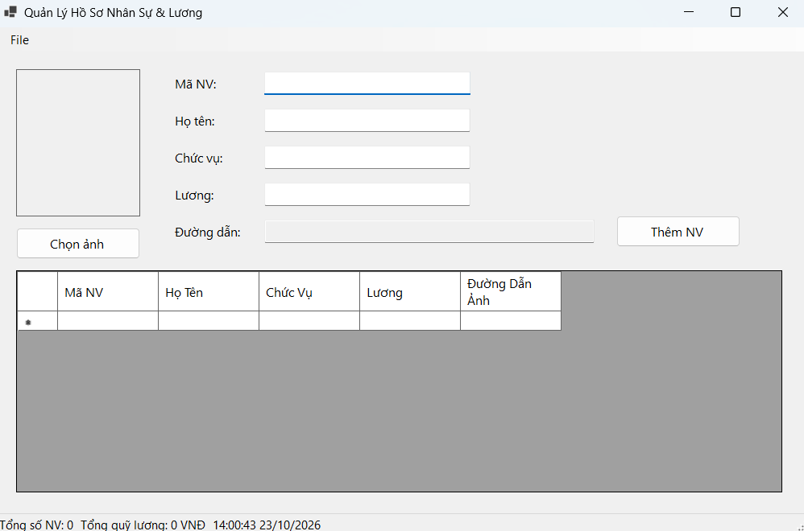 | 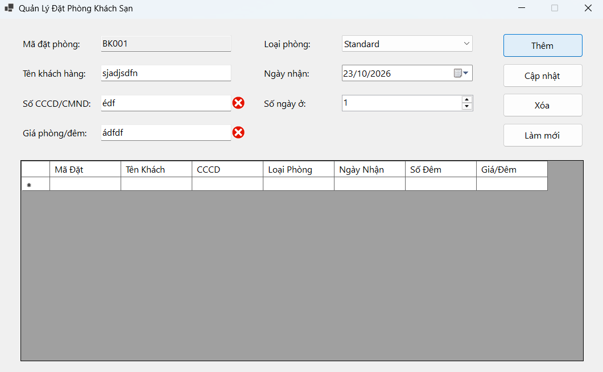 | 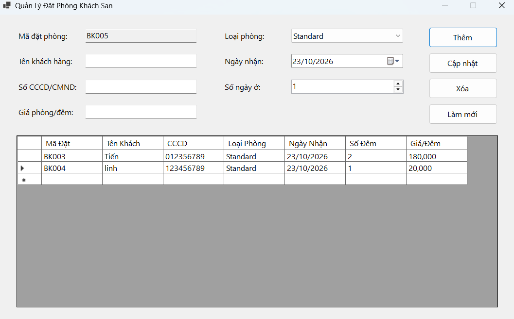 |

---

### BÀI 2: QUẢN LÝ HỒ SƠ NHÂN SỰ & THÔNG TIN LƯƠNG
- **Kỹ thuật thực hiện:** 
  - `OpenFileDialog` nạp ảnh chân dung nhân viên vào `PictureBox` và lưu đường dẫn.
  - `SaveFileDialog` và `OpenFileDialog` đọc/ghi dữ liệu chuẩn file `.csv`.
  - Tự động cập nhật tổng số nhân viên và quỹ lương lên `StatusStrip`.

| Giao diện & Avatar | Hộp thoại Đọc / Ghi CSV | Danh sách nạp từ CSV |
| :---: | :---: | :---: |
|  | 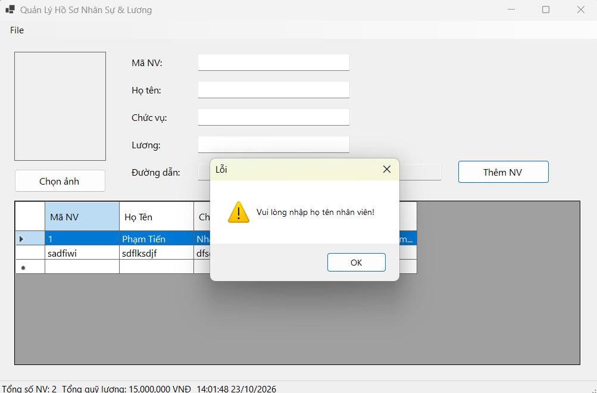 | 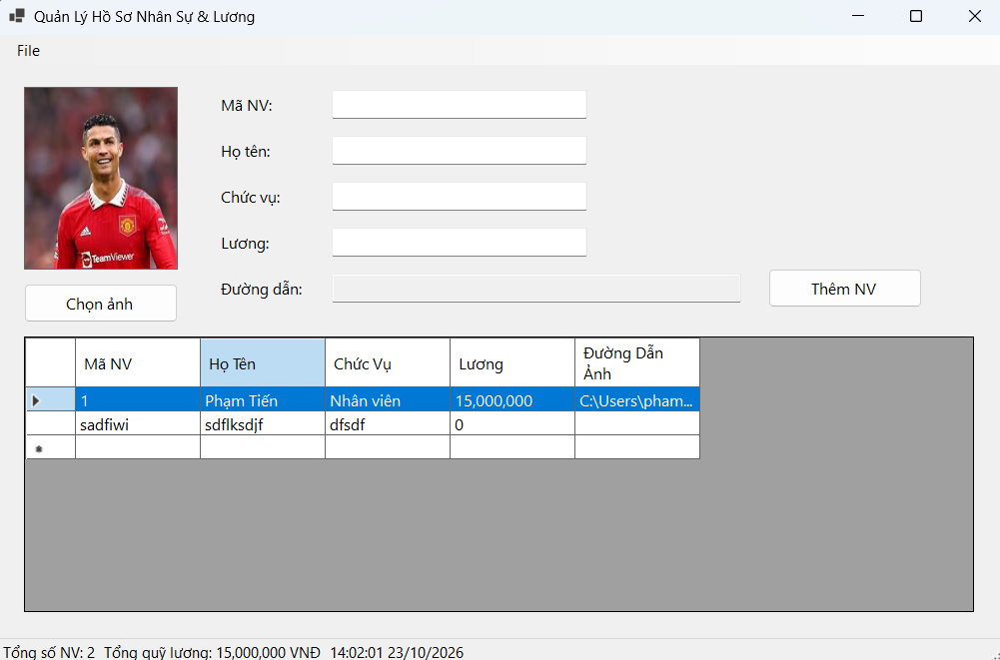 |

---

### BÀI 3: HỆ THỐNG MDI QUẢN LÝ TRƯỜNG HỌC & ĐÀO TẠO
- **Kỹ thuật thực hiện:** 
  - Form cha `IsMdiContainer = true`.
  - Duyệt mảng `MdiChildren` kiểm tra form mở sẵn để ngăn chặn duplicate (mở lặp lại), gọi `.Activate()`.
  - Điều hướng sắp xếp cửa sổ (`LayoutMdi`: Cascade, Tile Horizontal, Tile Vertical).

| Khung MDI & Form con | Xếp tầng (Cascade / Tile) | Ngăn chặn Duplicate Form |
| :---: | :---: | :---: |
| 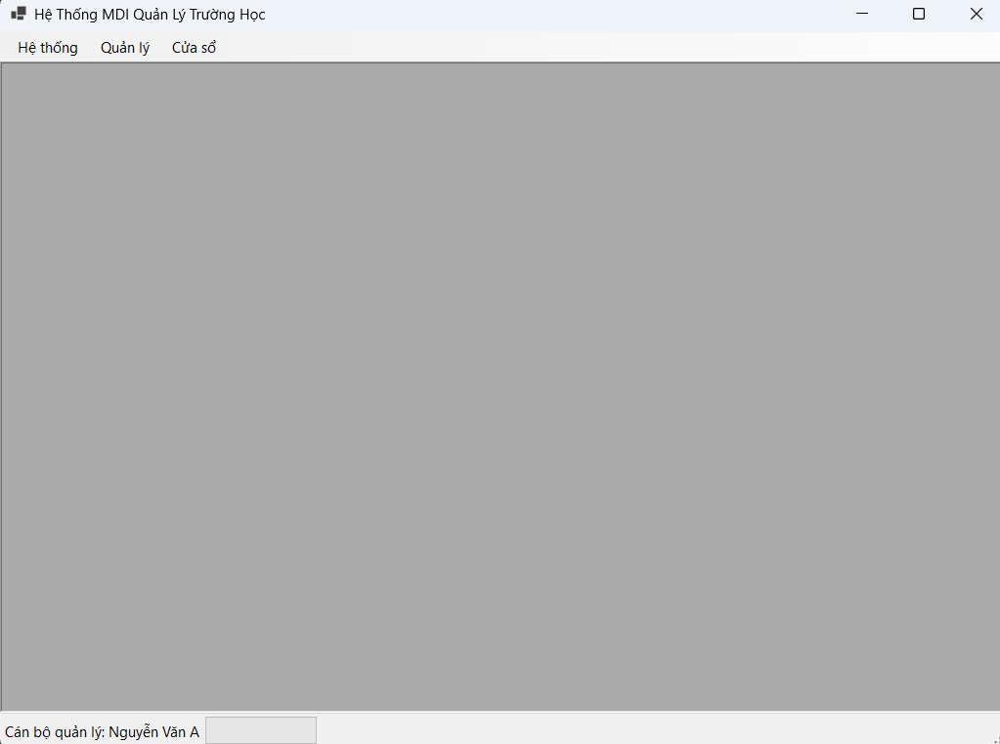 | 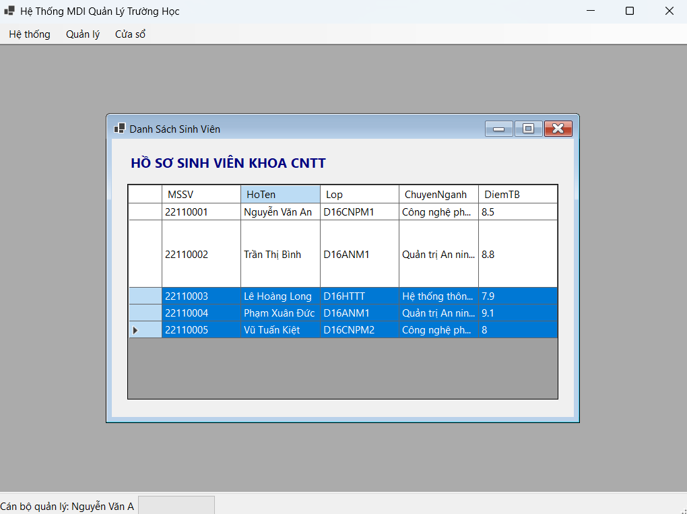 | 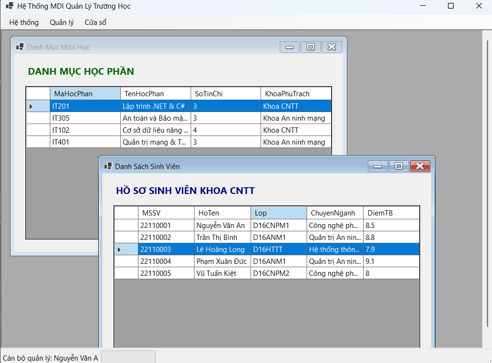 |

---

### BÀI 4: TỔNG HỢP BÁO CÁO KHO HÀNG (ASYNC / AWAIT)
- **Kỹ thuật thực hiện:** 
  - Dùng `await Task.Run(...)` đưa tác vụ quét nặng xuống Background Thread giúp Form không bị đơ giật (Not Responding).
  - Cập nhật tiến độ `ProgressBar` và `%` mượt mà qua `IProgress<int>`.
  - Hủy tác vụ an toàn bằng `CancellationTokenSource`.

| Đang tải (Không đơ Form) | Hủy tác vụ thành công | Kết quả tổng hợp báo cáo |
| :---: | :---: | :---: |
| 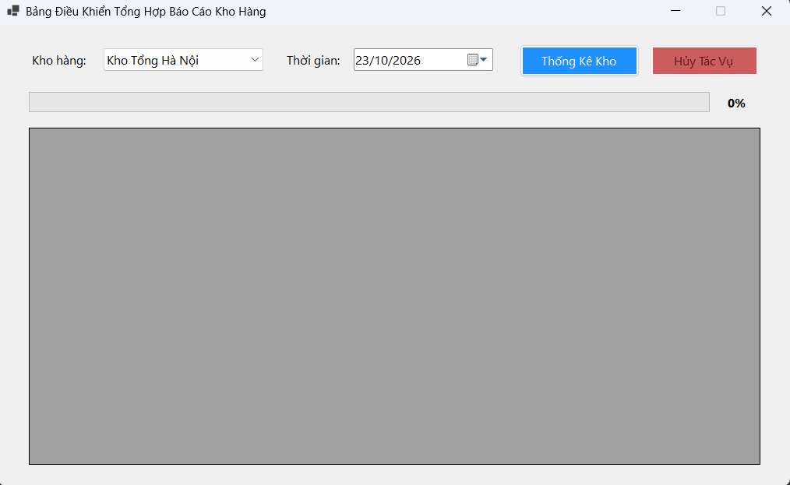 | 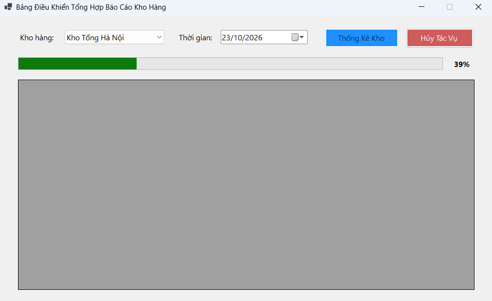 | 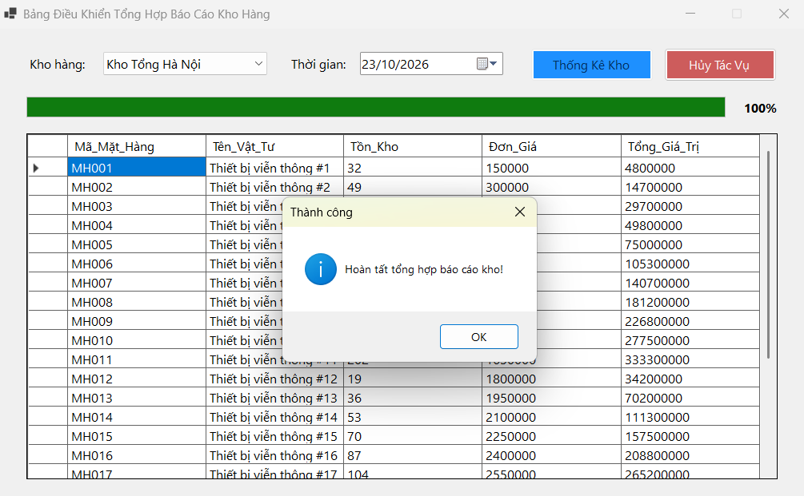 |

---

### BÀI 5: MÔ PHỎNG GIÁM SÁT IOT REAL-TIME (CROSS-THREAD SAFETY)
- **Kỹ thuật thực hiện:** 
  - Task chạy ngầm định kỳ 2 giây sinh ngẫu nhiên nhiệt độ từ 30°C - 42°C.
  - Xử lý Thread Safety bằng `this.InvokeRequired` và `this.Invoke()` (tránh lỗi `InvalidOperationException`).
  - Đổi màu nhãn cảnh báo (đỏ nếu > 37°C, xanh nếu bình thường) và ghi log vào DataGridView.

| Trạng thái Bình thường | Cảnh báo Vượt ngưỡng | Bảng Log & Đếm chu kỳ |
| :---: | :---: | :---: |
| 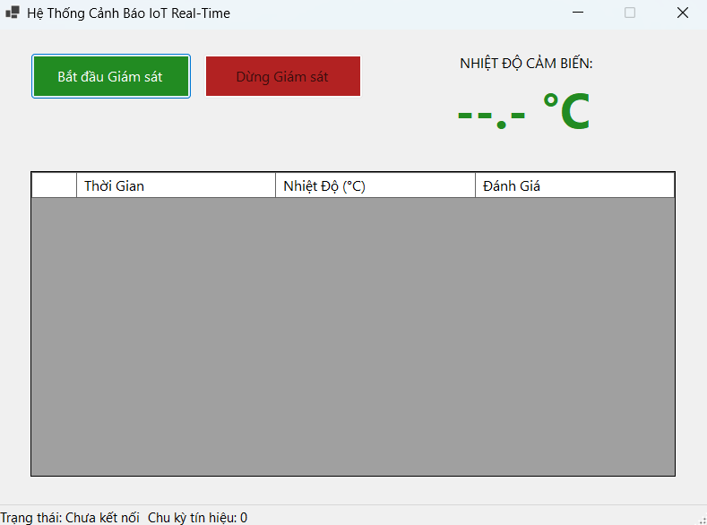 | 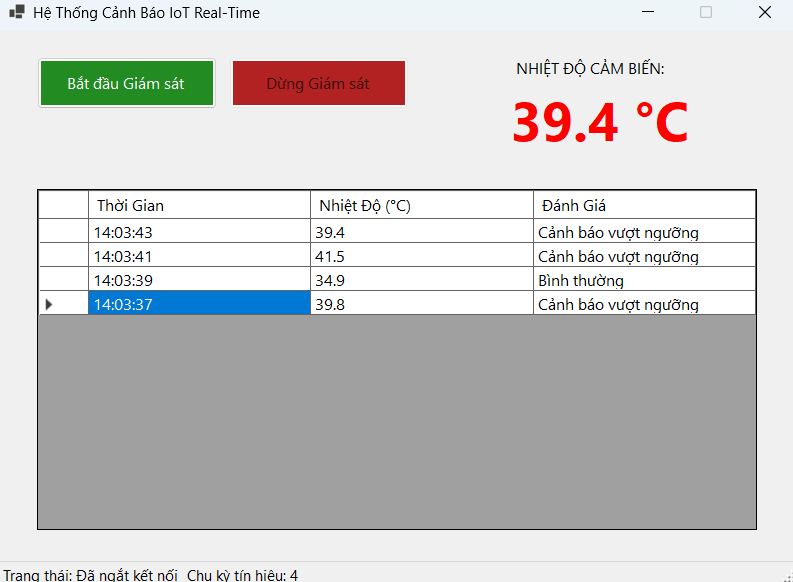 | 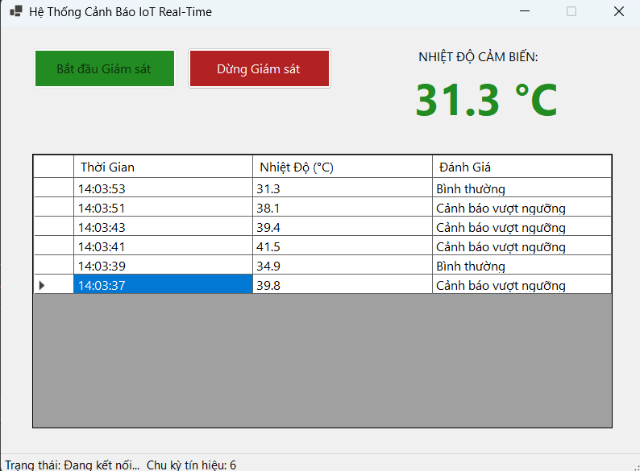 |

---

